<p align="center">
  
</p>

<h1 align="center">Student Assistant</h1>

<p align="center">
  Modules, timetable, tasks, exams and a smart study planner - in one app.<br/>
  <b>OPSC6312 Open Source Coding (Intermediate) · Portfolio of Evidence - Final submission (v3.0.0)</b><br/>
  Elijah Bopape · ST10445847
</p>

<p align="center">
  <a href="https://github.com/ElijahBopape/Open-Source-Coding-/actions/workflows/android-ci.yml"></a>
</p>

| | |
| --- | --- |
| 🎬 **Demonstration video** | **[https://youtu.be/iXGcTgkNHGk](https://youtu.be/iXGcTgkNHGk)** |
| 🌐 **Live REST API** | **<https://student-assistant-api-1dix.onrender.com>** (open it to see the health check; the free tier sleeps, so the first request takes about 50 s) |
| 📦 **Signed release / APK** | **[v3.0.0 release (signed APK)](https://github.com/ElijahBopape/Open-Source-Coding-/releases/tag/v3.0.0-final-poe)** |
| 📝 **Release notes** | [RELEASE_NOTES.md](RELEASE_NOTES.md) |
| 🤖 **AI usage write-up** | [AI_USAGE.md](AI_USAGE.md) |
| 🏷️ **Final PoE tag** | `v3.0.0-final-poe` |

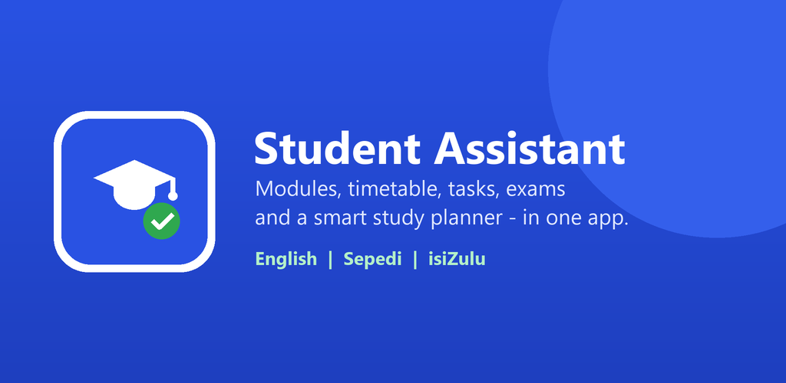

---

## Contents
1. [Purpose of the app](#1-purpose-of-the-app)
2. [Features and where to find them](#2-features-and-where-to-find-them)
3. [Screenshots](#3-screenshots)
4. [Design considerations](#4-design-considerations)
5. [Architecture](#5-architecture)
6. [REST API and NoSQL database](#6-rest-api-and-nosql-database)
7. [Running the project](#7-running-the-project)
8. [Testing](#8-testing)
9. [GitHub and GitHub Actions](#9-github-and-github-actions)
10. [Play Store preparation](#10-play-store-preparation)
11. [Release notes](#11-release-notes)
12. [AI usage and references](#12-ai-usage-and-references)

---

## 1. Purpose of the app

Tertiary students juggle a timetable, assignments, tests and exams across several modules. They usually do this with a generic calendar, a to-do list and notes that don't know about each other.

My Part 1 research compared **MyStudyLife**, **Microsoft To Do** and **Todoist**. It found an opportunity for a simpler, student-specific tool that **connects modules, tasks, classes and exams**, and that **tells the student what to work on first**.

Student Assistant does this. **Modules** are the foundation, and tasks, classes, exams and study sessions all link back to a module. The dashboard then answers one question: *"What needs my attention today?"*

## 2. Features and where to find them

### Required features (brief → implementation)

| Requirement | How it's done | Code |
| --- | --- | --- |
| Register and log in, with an encrypted password | Firebase Authentication. Passwords are salted and hashed (scrypt) by Firebase and never stored by the app. Validation on every field, plus "Forgot password?" | `ui/auth/LoginActivity.kt`, `RegisterActivity.kt` |
| **Single sign-on (SSO)** | "Continue with Google" through Android **Credential Manager**. The Google ID token is exchanged for a Firebase credential. | `ui/auth/GoogleSignInHelper.kt` |
| Settings the user can change | Name, profile photo, language, push notifications, dark theme, sync now, test push, sign out. Saved on the device **and** in the user's Firestore profile. | `ui/settings/SettingsFragment.kt` |
| REST API connected to a database, hosted online | Node.js + Express API on **Render**. It stores everything in **Cloud Firestore** (NoSQL) and verifies a Firebase ID token on every call. | `/backend` |
| **Offline mode with sync** | Tasks are stored in **Room (SQLite)** first, and changes are queued as *pending*. A **WorkManager** job syncs them when the device is back online. Other screens are cached for offline reading. | `data/local/`, `data/sync/` |
| **Real-time notifications** | **Firebase Cloud Messaging.** The API pushes when tasks or exams are added, plus daily deadline reminders. Local WorkManager reminders work offline. | `notifications/`, `backend/notify.js` |
| **Multi-language** (≥ 2 SA languages) | English, **Sepedi** (`values-b+nso`) and **isiZulu** (`values-zu`). Switches instantly using per-app locales. | `util/LocaleHelper.kt`, `res/values-*` |
| App icon and final image assets | Adaptive and themed launcher icon from the Part 1 logo, splash screen, Material icons, and a Play Store icon and feature graphic. | `res/mipmap-*`, `res/drawable/`, `playstore/` |
| Blob storage | Profile photos are uploaded to **Cloudinary**, and the URL is saved in Firestore. | `data/repository/ProfileRepository.kt` |

### User-defined features (from the Part 1 design)

| # | Feature | Design section |
| --- | --- | --- |
| 1 | **Module management:** create, edit and delete modules (name, code, lecturer, venue) | 3.3 |
| 2 | **Timetable:** weekly classes per day, with the next class shown on the dashboard | 3.4 |
| 3 | ★ **Tasks + Academic Priority System:** sorted by completion, priority and due date. **Exam-aware:** tasks for a module with an exam within 7 days are raised one level. | 3.5, 3.12 |
| 4 | ★ **Exams:** upcoming/past exams, countdown, marks and **average mark** (academic progress) | 3.6, 3.7 |
| 5 | ★ **Study Planner:** sessions linked to exams or tasks, progress tracking, and **Smart plan**, which spreads revision evenly before a deadline | 3.8, 3.12 |

## 3. Screenshots

Captured on a Pixel 7 emulator (Android 15) running the final build against the live API.

| Login (email + Google SSO) | Dashboard | Tasks (exam-aware priority) | Exams (average mark) |
| --- | --- | --- | --- |
| 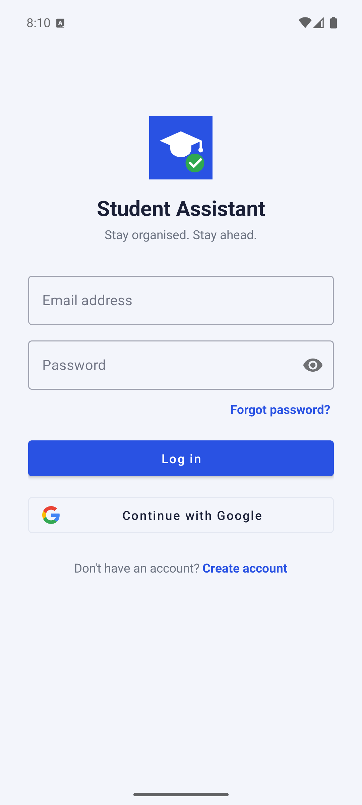 | 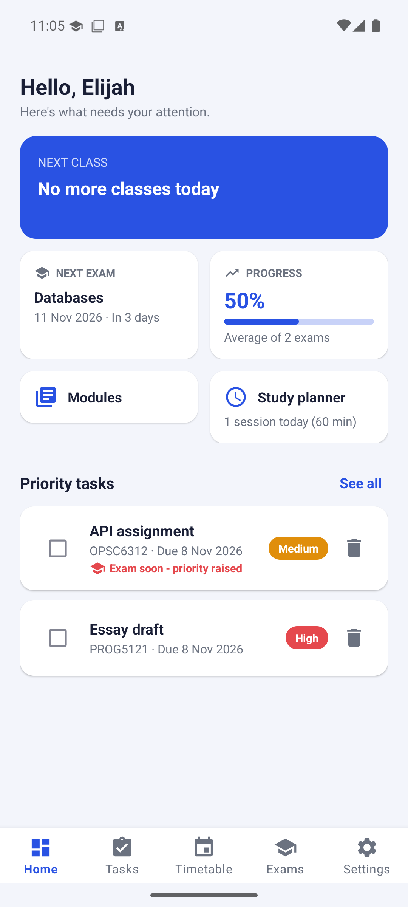 | 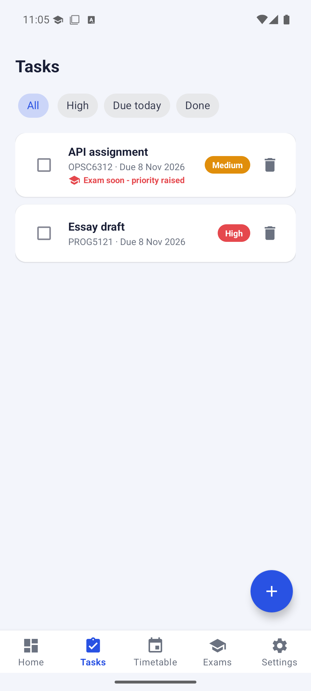 | 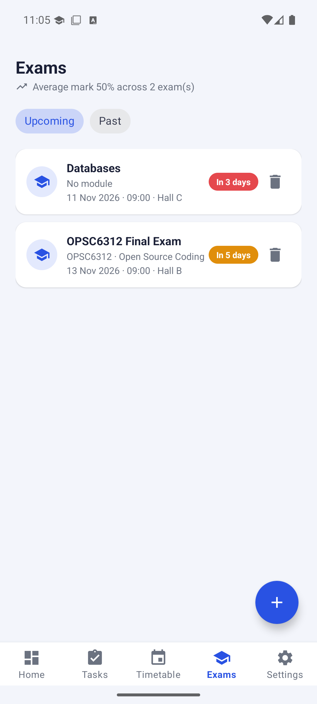 |

| Study planner | Settings | Sepedi | isiZulu |
| --- | --- | --- | --- |
| 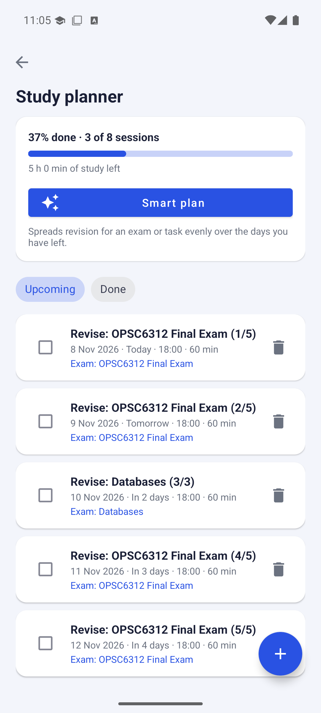 | 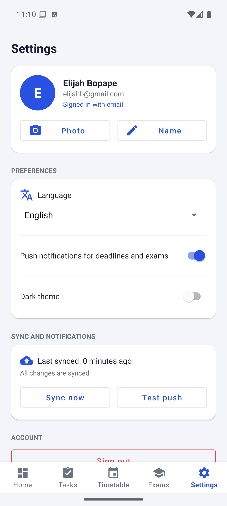 | 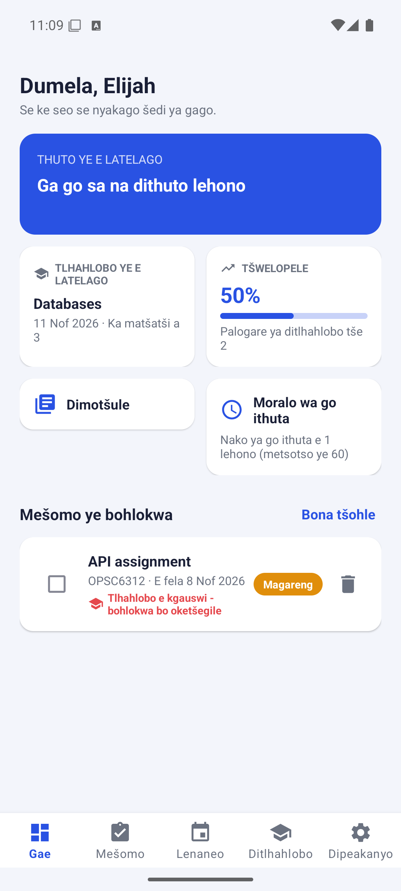 | 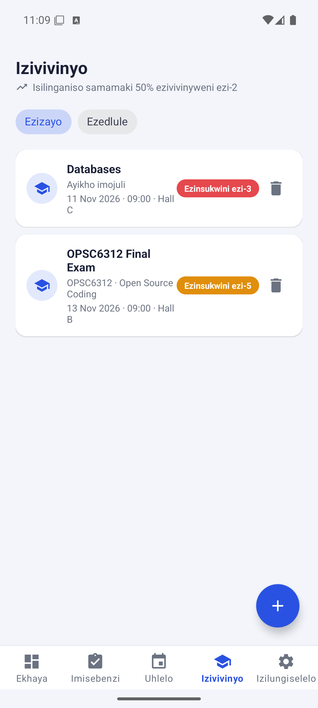 |

| Register (validated form) | Offline mode | Smart plan | Dark theme |
| --- | --- | --- | --- |
| 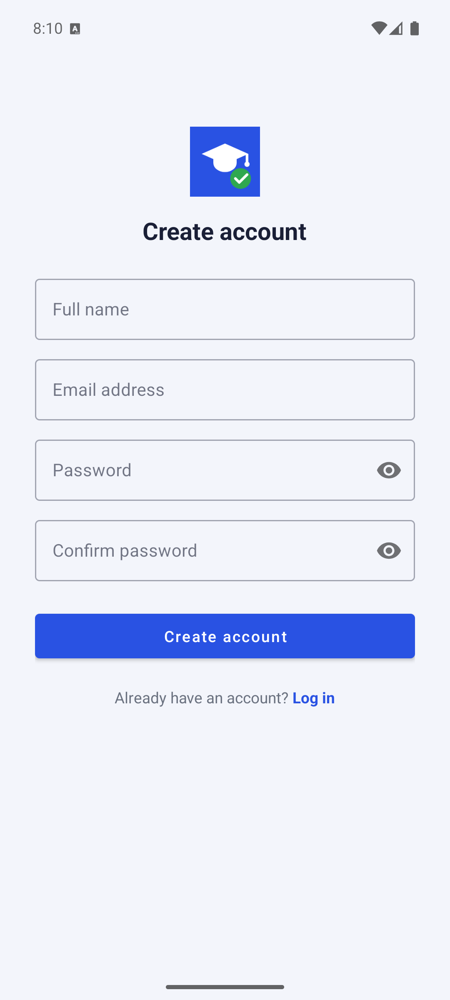 | 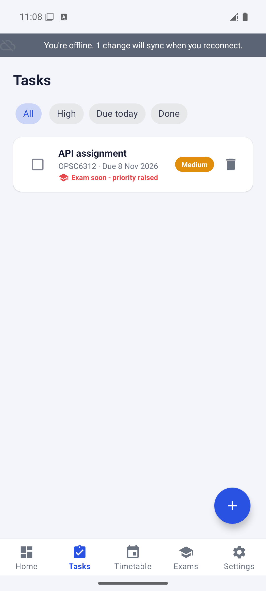 | 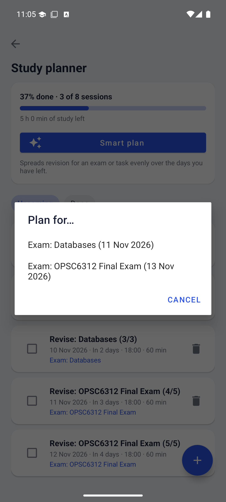 | 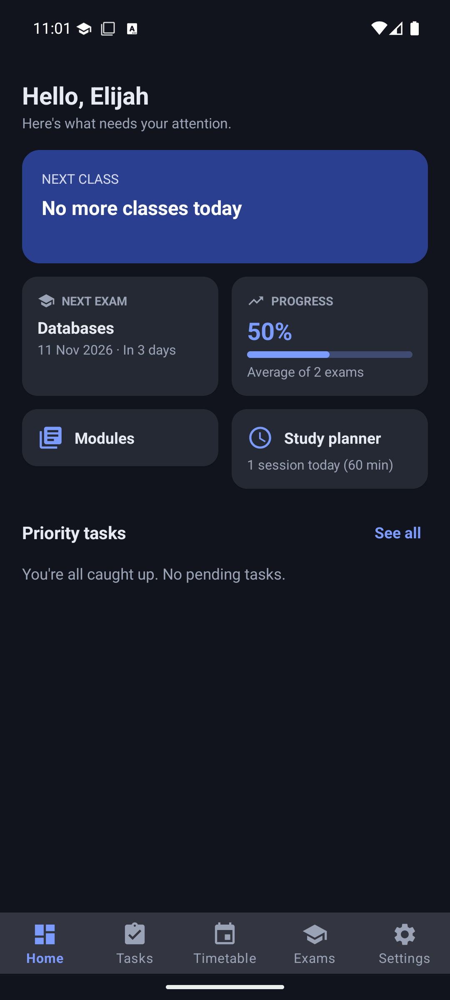 |

## 4. Design considerations

- **Material Design, one consistent visual system.** There is one blue-and-white palette, with a matching dark palette, and the same card, chip and form styles on every screen. Every colour is a named resource, so the dark theme changes the whole app consistently.
- **Navigation.** A bottom bar holds the five most-used destinations (Home, Tasks, Timetable, Exams, Settings). Modules and the Study Planner are one tap away on the dashboard. This keeps common actions to as few taps as possible, which was a design principle in Part 1.
- **Handling bad input without crashing.** Every form validates locally (required fields, valid dates and times, a 5–600 minute duration, a 0–100 mark, maximum lengths). The API validates again and returns `400`. All network calls go through `safeApiCall`, so a server or network error becomes a translated message instead of a crash.
- **Offline-first where it matters most.** Tasks are what students update most, often on campus with poor signal, so they work fully offline. Reference data (modules, timetable, exams, sessions) is cached for reading. A banner always shows when the user is offline and how many changes are waiting.
- **Conflict rule.** If a task was changed on the phone while offline, the phone's version wins at the next sync. The student's latest intent is never silently overwritten.
- **Security.** Each API request carries a short-lived Firebase **ID token**, which the server verifies. This replaces Part 2's trusted header. Release builds are HTTPS-only, and secrets (the service-account key, the upload keystore) are never committed.
- **Localisation done properly.** There are no hard-coded strings. Plurals are handled per language, and day and month names are translated (Java has no Sepedi date data). Languages are listed in their own names.
- **Changes from the Part 1 design.** The design proposed PHP + MySQL. The final build uses **Node.js + Cloud Firestore**, which meets the Part 3 learning outcome of reading and writing a NoSQL database, and runs on free hosting. The REST contract is unchanged.

## 5. Architecture

```
┌──────────────────────── Android app (Kotlin) ────────────────────────┐
│ UI: Activities + Fragments (View Binding, Material)                   │
│   ↓                                                                    │
│ Repositories ── Room (SQLite): tasks (offline-first) + API cache       │
│   │                ↑ TaskSyncEngine  ← SyncWorker (WorkManager)       │
│   ↓ Retrofit + OkHttp (AuthHeaderInterceptor: Firebase ID token)       │
└───┼──────────────────────────────────────────────────────────────────┘
    │ HTTPS                           ▲ FCM push
    ▼                                 │
┌──── REST API: Node.js/Express on Render ────┐      ┌── Firebase ─────────────┐
│ verifies ID token → per-user CRUD            │────▶ │ Authentication (users)  │
│ notify.js → FCM                              │────▶ │ Cloud Firestore (NoSQL) │
└──────────────────────────────────────────────┘      │ Cloud Messaging         │
Profile photos ──▶ Cloudinary (blob storage)           └─────────────────────────┘
```

Project layout:

```
app/src/main/java/com/bopape/studentassistant/
├── data/
│   ├── local/      Room database, entities, DAOs (offline mode)
│   ├── sync/       TaskSyncEngine, TaskMerge, SyncWorker, SyncScheduler
│   ├── remote/     Retrofit ApiService + auth interceptor
│   ├── repository/ one repository per feature (+ Cloudinary upload)
│   └── model/      Module, Task, TimetableEntry, Exam, StudySession, UserProfile
├── notifications/  FCM service, push registration, daily ReminderWorker
├── ui/             auth, dashboard, modules, tasks, timetable, exams, study, settings, main
└── util/           PriorityUtils, StudyPlanner, DateUtils, LocaleHelper, NetworkMonitor
backend/            Express API (server.js, store.js, notify.js, routes/, test/)
playstore/          icon, feature graphic, screenshots, store listing, privacy policy
```

The app logs throughout with `android.util.Log` (filter Logcat by `TaskSyncEngine`, `StudentMessaging`, `GoogleSignInHelper` and others). The API logs every request and push to Render's *Logs* tab.

## 6. REST API and NoSQL database

Base URL: **https://student-assistant-api-1dix.onrender.com**. All `/api` routes need `Authorization: Bearer <Firebase ID token>`.

| Method | Endpoint | Purpose |
| --- | --- | --- |
| GET | `/` | Health check (shows database = `firestore`) |
| GET/POST/PUT/DELETE | `/api/modules[/:id]` | Modules |
| GET/POST/PUT/DELETE | `/api/tasks[/:id]` | Tasks (POST sends a push) |
| GET/POST/PUT/DELETE | `/api/timetable[/:id]` | Timetable entries |
| GET/POST/PUT/DELETE | `/api/exams[/:id]` | Exams (POST sends a push) |
| GET/POST/PUT/DELETE | `/api/study-sessions[/:id]` | Study sessions |
| GET/PUT | `/api/profile` | Name, language, theme, notifications, photo URL |
| POST/DELETE | `/api/devices[/:token]` | Register or unregister an FCM token |
| POST | `/api/notifications/test` · `/reminders` | Send a test push or due-soon reminders |

**Firestore layout.** There are top-level collections `modules`, `tasks`, `timetable`, `exams`, `studySessions` and `devices`. Each document holds `userId` (the Firebase UID), the record fields, and `createdAt`/`updatedAt`. Each user's profile and settings are in `users/{uid}`. `counters/{collection}` allocates ids inside a transaction.

## 7. Running the project

**For the marker:** clone the repo, open the root folder in Android Studio and press **Run**. The committed `google-services.json` is the real Firebase config, and the app already points at the live API, so nothing else needs setting up. Use a device or emulator image **with Google Play** so that Google Sign-In and push notifications work.

```bash
./gradlew assembleDebug          # debug APK
./gradlew bundleRelease          # Play Store bundle (signed if keystore.properties exists)
```

**Optional: run the API locally.**

```bash
cd backend && npm install && npm start      # http://localhost:3000, uses a local JSON store
# then add to local.properties:  api.baseUrl=http://10.0.2.2:3000/
```

To use Firestore locally, set `GOOGLE_APPLICATION_CREDENTIALS` to a service-account file. To deploy, use Render → **New → Blueprint** on this repo (it reads `backend/render.yaml`), and set `FIREBASE_SERVICE_ACCOUNT` to the service-account JSON.

## 8. Testing

| Suite | Command | What it covers |
| --- | --- | --- |
| Android unit tests (23) | `./gradlew testDebugUnitTest` | Academic Priority System and exam boost, offline-sync merge and conflict rules, Smart plan scheduling, progress and average mark, translated dates, language mapping |
| API tests (10) | `cd backend && npm test` | Auth required, CRUD round trip, input validation, user isolation, exams and marks, study sessions, profile/language, device registration, reminder rules |
| UI test | `./gradlew connectedAndroidTest` | The login screen rejects an empty form without crashing |

## 9. GitHub and GitHub Actions

- The code is committed in small, described commits, one per feature (`git log`). There are no zip uploads.
- `.github/workflows/android-ci.yml` runs on every push and pull request. It has two jobs:
  1. **API tests:** Node 20, `npm ci && npm test`.
  2. **Android:** JDK 17, unit tests, the debug APK and the R8 release bundle. The APK and test report are uploaded as artifacts.
- The final commit is tagged **`v3.0.0-final-poe`**.

## 10. Play Store preparation

- `targetSdk 36`, `versionCode 3`, `versionName 3.0.0`, with R8 shrinking and resource shrinking.
- **Signed with an upload key.** The key is stored locally in `keystore.properties` and the `.jks` file, which are git-ignored. Its SHA-1 is registered in Firebase.
- Store graphics: [icon 512×512](playstore/icon-512.png), [feature graphic 1024×500](playstore/feature-graphic-1024x500.png) and [phone screenshots](playstore/screenshots).
- [Store listing text, content rating and data-safety answers](playstore/STORE_LISTING.md), plus the [privacy policy](playstore/PRIVACY_POLICY.md).
- I don't have a Google Play developer account, so the bundle was not uploaded to the Play Console (the brief marks this "if applicable"). Everything needed to upload it is in this repository.

## 11. Release notes

See **[RELEASE_NOTES.md](RELEASE_NOTES.md)** for every update since the Part 2 prototype. In short, v3.0.0 adds:
- Google SSO
- offline mode with sync
- FCM push notifications
- Sepedi and isiZulu
- ★ Exams with marks
- ★ the Study Planner with Smart plan
- ★ the exam-aware priority system
- Cloud Firestore storage, ID-token security, Cloudinary photos, and Play Store readiness.

## 12. AI usage and references

AI assistance is disclosed in **[AI_USAGE.md](AI_USAGE.md)**.

References:
- Android Developers (2026) *Save data in a local database using Room.* Available at: https://developer.android.com/training/data-storage/room
- Android Developers (2026) *Schedule tasks with WorkManager.* Available at: https://developer.android.com/develop/background-work/background-tasks/persistent/getting-started
- Android Developers (2026) *Authenticate users with Sign in with Google.* Available at: https://developer.android.com/identity/sign-in/credential-manager-siwg
- Android Developers (2026) *Per-app language preferences.* Available at: https://developer.android.com/guide/topics/resources/app-languages
- Android Developers (2026) *Sign your app.* Available at: https://developer.android.com/studio/publish/app-signing
- Google (2026) *Firebase Cloud Messaging.* Available at: https://firebase.google.com/docs/cloud-messaging
- Google (2026) *Cloud Firestore: add data / transactions.* Available at: https://firebase.google.com/docs/firestore
- Google (2026) *Verify ID tokens.* Available at: https://firebase.google.com/docs/auth/admin/verify-id-tokens
- Cloudinary (2026) *Upload API - unsigned upload.* Available at: https://cloudinary.com/documentation/image_upload_api_reference
- Square (2026) *Retrofit.* Available at: https://square.github.io/retrofit/
- Render (2026) *Blueprint specification.* Available at: https://render.com/docs/blueprint-spec
- Google (2026) *Material Icons* (Apache 2.0). Available at: https://fonts.google.com/icons
- The Independent Institute of Education (2026) *OPSC6312 Portfolio of Evidence.*
